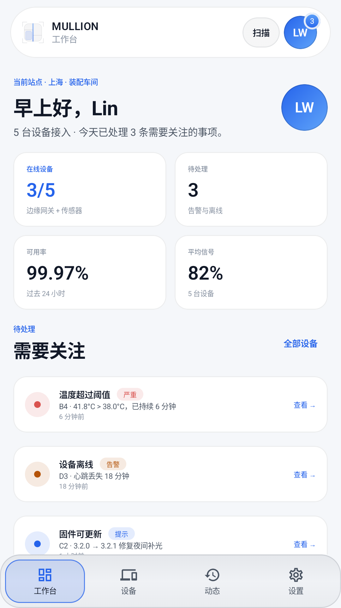
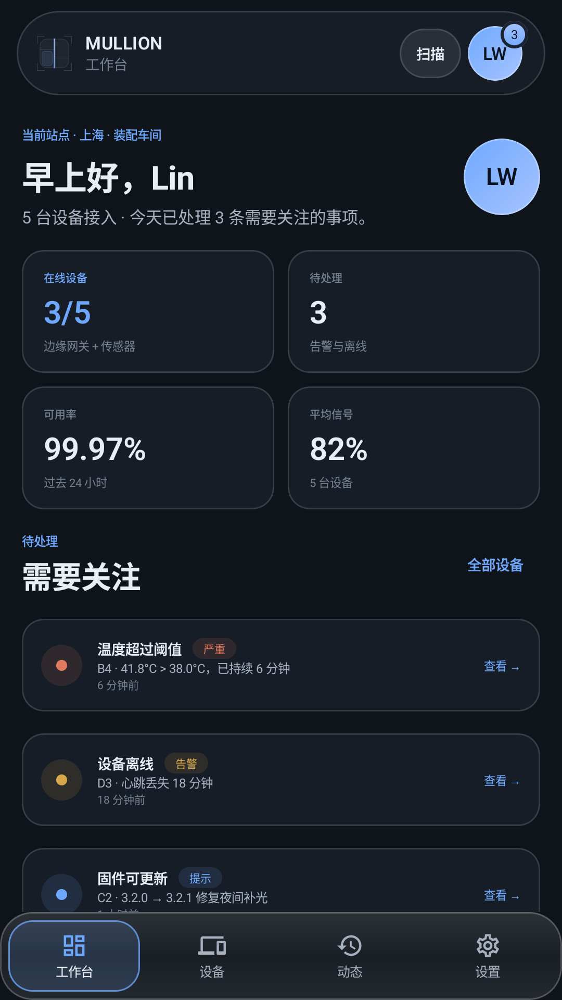
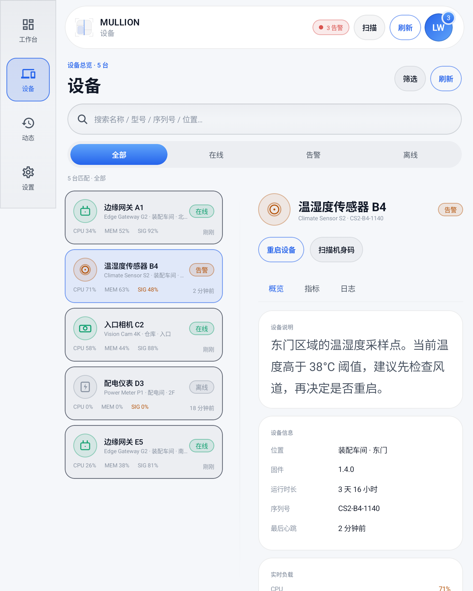
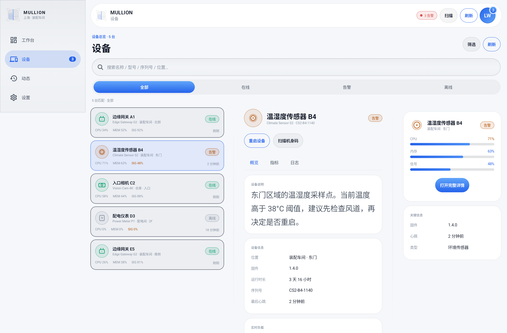
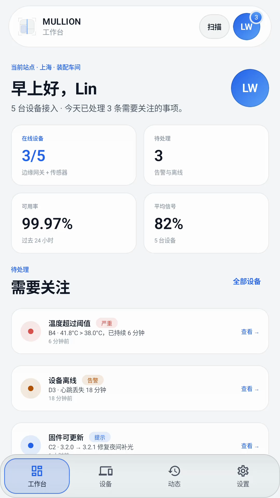
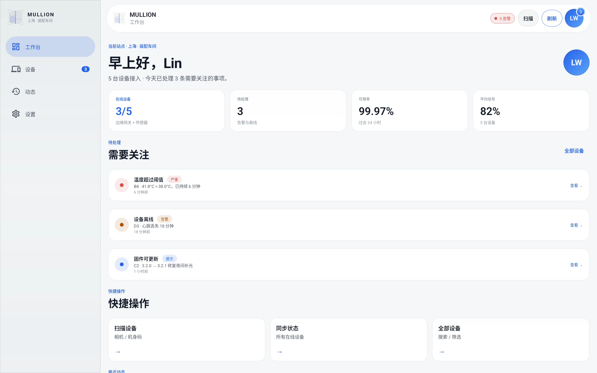

# MULLION

**One window. Every pane. / 一樘窗，处处合缝。**

[](LICENSE)
[](https://developer.android.com/tools/revisions/platforms)
[](https://kotlinlang.org)
[](https://developer.android.com/jetpack/compose)
[](#the-26-modules)
[](https://jitpack.io/#Mullion-Official/Mullion-Android-Kotlin-Compose)



> 一樘窗如何分格，由窗棂决定。Mullion 是把一扇大窗分成若干玻璃格的结构件——它不发光、不抢眼，却决定了窗格如何排布、如何收束、如何避让铰链。组件库之于应用界面，正是这根窗棂：**320dp 到 1200dp 之间，一切分格由它定。**

MULLION 是一个开源的 **Android 原生自适应组件框架**。它不是又一套“把 Material 组件换个颜色”的库，而是把宽度类、导航形态、分栏策略、折叠屏几何和窗口 inset 收束成一根可测试的窗棂，让业务 Screen 里不再出现 `if (width > 600)`。

示例 App 不是组件清单，而是一个可运行的 **设备运维控制台**：仓库/产线设备的工作台、搜索筛选、列表-详情-预览、远程重启确认、运行时权限、动态时间线和设置。26 个组件的“组件柜”保留为独立入口，用来单独查阅视觉与 API。

- **Compose + View 双端**：`mullion-compose` 26 个组件；`mullion-view` 提供可混入既有 XML 工程的布局与玻璃 View。
- **5 档宽度类**：320 / 480 / 600 / 840 / 1200 dp，同一份判定驱动导航、栏数、资源桶与字阶。
- **折叠屏是几何**：`DockedSheet` 永不跨缝，`FoldablePane` 在窗格不足时退回单栏；`MultiPane` 还会在内容宽度不足时主动收起预览栏。
- **明暗自适应**：默认跟随系统，组件只读语义 token；Compose 与 View 各有一套 light / night 映射，不靠 `if (dark)` 散落在业务里。
- **真实工程示范**：`DeviceRepository` + `ViewModel` + `StateFlow`，含加载态、错误路径、筛选后选择清理、真实 `RequestMultiplePermissions` 流程。
- **零反射**：断点阈值是 `const`，解析是纯函数；资源桶由 Android configuration 在编译期/配置期选择。
- **Apache-2.0**：核心、Compose、View 三个模块都可独立发布。

---

## 目录

- [为什么是 MULLION](#为什么是-mullion)
- [实机预览](#实机预览)
- [演示视频](#演示视频)
- [明暗主题](#明暗主题)
- [参考应用：设备运维控制台](#参考应用设备运维控制台)
- [快速开始](#快速开始)
- [一根窗棂：断点表](#一根窗棂断点表)
- [26 个模块](#the-26-modules)
- [Compose 用法](#compose-用法)
- [View 用法](#view-用法)
- [折叠屏与铰链](#折叠屏与铰链)
- [工程结构](#工程结构)
- [构建与测试](#构建与测试)
- [文档](#文档)
- [贡献与许可](#贡献与许可)

---

## 为什么是 MULLION

Android 的适配难，不在于写不出一个 `if`，而在于每个 Screen 都写了不同版本的 `if`：

- 底部栏阈值在一个页面是 600dp，在另一个页面是 599dp；
- 列表/详情两栏在平板上能开，在折叠屏上会跨过铰链；
- 键盘弹出时有的页面 `imePadding()`，有的页面被遮住；
- Compose 写了一套布局，老的 View 页面只能再写一套。

MULLION 把这些判断上移成 **一个窗口状态** 和 **一份结构策略**：

```text
          320 ───── 480 ───── 600 ───── 840 ───── 1200 ─────▶
            Compact   Medium    Expanded   Large      XL
nav         BottomBar BottomBar Rail       Drawer     Drawer
panes       1         1         2          3          3
bucket      values    values    w600dp     w840dp     w840dp
```

每一档的 `Bp` 是普通 enum 常量，`Bp.of(widthDp)` 是纯 `when`。R8 可以内联、折叠，运行时没有反射，也没有字典查找。

## 实机预览

| 浅色 · 手机 411dp | 深色 · 同一界面 |
| --- | --- |
|  |  |

| 折叠屏展开 · 673dp 两栏 | 1280dp · 列表 / 详情 / 预览 |
| --- | --- |
|  |  |

> 以上都是示例 App 在 Android 16 / API 36 模拟器上的真实 Compose 渲染。浅色与深色由系统切换，同一套组件代码不变；411dp 使用 BottomBar，673dp 使用 Rail，914dp 的 Drawer 让内容区变窄时 `MultiPane` 会自动从三栏退回两栏，1280dp 恢复三栏。截图使用 `demo_fullscreen` 隐藏系统栏，普通启动保留状态栏/导航栏安全区。

## 明暗主题

```kotlin
// 默认跟随系统（isSystemInDarkTheme）
MullionTheme {
    App()
}

// 设计稿、截图测试或 kiosk 可以固定
MullionTheme(darkTheme = false) { App() }
```

- Compose 侧：`MullionPalette` + `LocalMullionPalette`，`MullionColors` 保留为可组合 token 门面；亮/暗两套 semantic token 同步切换。
- View 侧：`values/colors.xml` 与 `values-night/colors.xml`，`MullionPalette.of(context)`；`MullionGlassLayout` / `MullionButtonView` 在配置变化时重建渐变与文字色。
- 玻璃配方也随主题切换 tint：浅色用低透明度深色玻璃，深色用白色玻璃，不再假设“组件只存在于黑底”。
- 示例 App 的设置页会显示“浅色 / 深色 · 跟随系统”，并已验证系统切换时即时换肤。

## 不把 dp 丢给业务代码

MULLION 的规则是：**dp 只允许出现在标尺层，不允许出现在业务 Screen 的适配逻辑里。**

```kotlin
// ❌ 业务代码自己猜 padding、自己输入栏间距
Row(Modifier.padding(24.dp))
MultiPane(strategy = PaneStrategy(gutterDp = 24))

// ✅ 从窗口上下文读同一把标尺
Row(Modifier.padding(mullionDimens().screenPadding))
MultiPane(strategy = PaneStrategy()) // gutter 由当前 Bp 的 MullionMetrics 决定
```

- `MullionDimens.forBp(bp, fontScale)` 根据宽度类与字体缩放派生出页面边距、卡片内边距、栏间距、对话框宽度、三栏最小详情宽度。
- `mullionDimens()` / `LocalMullionDimens` 是唯一入口；`MullionWindowProvider` 在模拟窗口时会同步覆盖它，预览与真实窗口不会用到两把尺。
- `PaneStrategy.gutterDp` 默认是 `null`，由 `MullionMetrics` 自动决定；显式传值只用于设计例外。
- 预览/截图不写 `375 / 760 / 1180`，用 `MullionViewport.Phone / Fold / Desktop` 语义常量。
- Android View 的 XML 仍需要 dimension 属性，这是平台约束；默认值应与 `values-w*` 桶一致。

## 演示视频

### 竖版 · 47 秒

[](docs/media/mullion-demo.mp4)

**[▶ 观看 / 下载竖版演示片](docs/media/mullion-demo.mp4)** · 1080×1920 · 30fps · H.264 · 无音轨（方便你在抖音里配乐）

镜头：浅色工作台 → 设备详情 → 指标 / 日志 → 设置，然后切到系统深色，同一套界面即时换肤。

### 大屏 · 52 秒

[](docs/media/mullion-large-screen.mp4)

**[▶ 观看 / 下载大屏演示片](docs/media/mullion-large-screen.mp4)** · 2560×1600（16:10）· 30fps · H.264 · 无音轨

镜头：1280dp 大屏工作台 → Drawer 导航 → 设备列表 / 详情 / 预览三栏 → 指标 / 日志 → 侧滑重启确认 → 权限面板。画面来自真机模拟器上的参考应用，不是拉伸后的手机截图。

## 参考应用：设备运维控制台

参考应用选择了一个真实的 B 端场景：值班工程师在手机、折叠屏、平板上巡视产线设备。它不是为了展示 26 个组件而堆卡片，而是把这些工程问题落在一套可运行的代码里。

### 分层

```text
MainActivity
  └─ ReferenceApp                窗口 / 导航 / 权限 / Snackbar / 弹层
       ├─ WorkbenchScreen        工作台：KPI、告警、快捷操作、动态
       ├─ DevicesScreen          搜索、筛选、列表 / 详情 / 预览、分栏降级
       ├─ ActivityScreen         动态时间线
       └─ SettingsScreen         站点、通知、栏距、权限、窗口诊断
            └─ ReferenceViewModel    StateFlow<ReferenceUiState> + 命令
                 └─ DeviceRepository  接口；InMemoryDeviceRepository 实现
```

- **数据层**：`DeviceRepository` 定义 `load / refresh / restart`，假实现带 420–1050ms 延迟；离线设备重启会返回失败，UI 必须处理。
- **状态层**：`ReferenceViewModel` 持有不可变 `ReferenceUiState`，用 `StateFlow` 暴露；搜索、筛选、详情 tab、权限、重启目标都是状态，不是散落在 Composable 里的 `remember`。
- **真实动作**：远程重启前 `AdaptiveDialog` 确认；确认后按钮进入 loading，成功后更新设备、告警和动态并弹 Snackbar；离线设备直接报错。
- **真实权限**：`PermissionSheet` 是产品自己的解释层，确认后走 `ActivityResultContracts.RequestMultiplePermissions`，系统弹窗的结果回写权限地图；设置页显示“已授予 / 未授予”。
- **选择一致性**：筛选或搜索把当前选中设备隐藏时，ViewModel 会清掉 selection；宽屏由 `DevicesScreen` 自动选中第一台可见设备，窄屏回到列表。
- **系统返回**：窄屏详情按返回键回到列表，而不是直接退出 Activity。

### 自适应行为

| 窗口 | 导航 | 设备页 | 说明 |
| --- | --- | --- | --- |
| 411dp | BottomBar | 列表 → 详情 | 单栏；详情顶部有返回；系统返回可用 |
| 673dp（折叠屏展开） | Rail | 列表 + 详情 | 两栏；侧栏不占满内容 |
| 914dp（Drawer 打开） | Drawer | 列表 + 详情 | 内容区被 Drawer 压窄，`MultiPane` 主动收起预览，避免详情被压成单字列 |
| 1280dp | Drawer | 列表 + 详情 + 预览 | 三栏；预览提供快速指标和“打开完整详情” |

> 第 4 行的降级逻辑是这次工程化里最重要的修复：窗口类到达 `Large` 并不代表内容区一定够宽。`MultiPane` / `SearchLayout` 现在按**实际约束**判断，而不是盲信 `Bp`。

### 关键代码

- [`ReferenceData.kt`](sample/src/main/kotlin/dev/mullion/sample/reference/ReferenceData.kt)：设备、告警、动态模型与 Repository。
- [`ReferenceViewModel.kt`](sample/src/main/kotlin/dev/mullion/sample/reference/ReferenceViewModel.kt)：状态、筛选清理、重启、权限结果。
- [`ReferenceApp.kt`](sample/src/main/kotlin/dev/mullion/sample/reference/ReferenceApp.kt)：壳层、导航、`AdaptiveDialog`、`PermissionSheet`、Snackbar。
- [`DevicesScreen.kt`](sample/src/main/kotlin/dev/mullion/sample/reference/DevicesScreen.kt)：搜索、筛选、`MultiPane`、详情 tab、侧滑筛选。
- [`WorkbenchScreen.kt`](sample/src/main/kotlin/dev/mullion/sample/reference/WorkbenchScreen.kt)、[`SettingsScreen.kt`](sample/src/main/kotlin/dev/mullion/sample/reference/SettingsScreen.kt)：真实业务内容。
- [`CabinetActivity.kt`](sample/src/main/kotlin/dev/mullion/sample/CabinetActivity.kt)：独立组件柜，不与业务壳耦合。

### 组件柜

26 个组件的玻璃陈列仍在：设置 → 工具 → 组件柜。它负责“看组件”，参考应用负责“看工程”。两者共用同一套 `mullion-compose`，组件柜不再是示例 App 的首页。

## 快速开始

### 从源码构建

需要 **JDK 17+**、**Android SDK 36**。`local.properties` 里写入 `sdk.dir`（Android Studio 会自动生成）。

```bash
git clone https://github.com/Mullion-Official/Mullion-Android-Kotlin-Compose.git
cd Mullion-Android-Kotlin-Compose
./gradlew :sample:installDebug
```

安装后启动的是 **参考应用**（设备运维控制台）。要看 26 组件柜：进入「设置 → 工具 → 组件柜」。录屏时可以用 `adb shell am start -n dev.mullion.sample/.MainActivity --ez demo_fullscreen true` 隐藏系统栏。

也可以只构建库：

```bash
./gradlew :mullion-core:assembleRelease :mullion-compose:assembleRelease :mullion-view:assembleRelease
```

### 从 JitPack 引入（当前可直接使用）

JitPack 已按 tag `1.0.0` 构建通过，三个模块可分别依赖：

```kotlin
// settings.gradle.kts
dependencyResolutionManagement {
    repositories {
        google()
        mavenCentral()
        maven { url = uri("https://jitpack.io") }
    }
}
```

```kotlin
dependencies {
    implementation("com.github.Mullion-Official.Mullion-Android-Kotlin-Compose:mullion-core:1.0.0")
    implementation("com.github.Mullion-Official.Mullion-Android-Kotlin-Compose:mullion-compose:1.0.0")
    implementation("com.github.Mullion-Official.Mullion-Android-Kotlin-Compose:mullion-view:1.0.0")
}
```

| 模块 | 坐标 | 内容 |
| --- | --- | --- |
| `mullion-core` | `…:mullion-core:1.0.0` | 断点、分栏、折叠几何、窗口状态 |
| `mullion-compose` | `…:mullion-compose:1.0.0` | 26 个 Compose 组件与主题 |
| `mullion-view` | `…:mullion-view:1.0.0` | Android View / XML 布局与玻璃 View |

- `mullion-compose`、`mullion-view` 会传递依赖 `mullion-core`；只做 Compose 工程时只引 `mullion-compose` 即可。
- 一次引入三个模块可用聚合坐标：

```kotlin
implementation("com.github.Mullion-Official:Mullion-Android-Kotlin-Compose:1.0.0")
```

- 版本号就是 Git tag；根目录 [`jitpack.yml`](jitpack.yml) 固定执行三个模块的 `publishToMavenLocal`，避免 JitPack 只抓到 sample。
- JitPack 构建页：https://jitpack.io/#Mullion-Official/Mullion-Android-Kotlin-Compose/1.0.0

### 本地 / Maven Central（预留）

`dev.mullion:core`、`dev.mullion:compose`、`dev.mullion:view` 是源码内的常规发布坐标，仓库已配置 `maven-publish` 与 sources jar；它们**没有声称已经在 Maven Central 上线**。需要时可用：

```bash
./gradlew :mullion-core:publishReleasePublicationToLocalRepoRepository \
  :mullion-compose:publishReleasePublicationToLocalRepoRepository \
  :mullion-view:publishReleasePublicationToLocalRepoRepository
```

发布到 `build/repo`，或按 `docs/publishing.md` 接到自己的私有仓库 / Central 流程。

### 一个最小 Compose 应用

```kotlin
class MainActivity : ComponentActivity() {
    override fun onCreate(savedInstanceState: Bundle?) {
        enableEdgeToEdge()
        super.onCreate(savedInstanceState)
        setContent {
            MullionTheme {
                MullionWindowProvider {
                    MullionApp()
                }
            }
        }
    }
}

@Composable
fun MullionApp() {
    val items = listOf(
        OrbitNavItem("工作台"),
        OrbitNavItem("消息"),
        OrbitNavItem("设备"),
        OrbitNavItem("设置"),
    )
    var selected by remember { mutableIntStateOf(0) }

    AdaptiveScaffold(
        topBar = { Text("MULLION") },
        bottomBar = { OrbitNav(items, selected, onSelect = { selected = it }) },
        rail = { OrbitNav(items, selected, onSelect = { selected = it }) },
        drawer = { OrbitNav(items, selected, onSelect = { selected = it }) },
    ) {
        MultiPane(
            list = { ScreenList() },
            detail = { ScreenDetail() },
            preview = { ScreenPreview() },
        )
    }
}
```

`AdaptiveScaffold` 与 `MultiPane` 内部读取 `LocalMullionWindow`，业务代码不出现任何宽度判断。

## 一根窗棂：断点表

| 宽度 | 类 | 导航 | 主栏数 | 资源桶 | Section / Type |
| --- | --- | --- | --- | --- | --- |
| 0–479dp（设计基线 320） | `Compact` | `BottomBar` | 1 | `values` | 48dp / 32sp |
| 480–599dp | `Medium` | `BottomBar` | 1 | `values` | 48dp / 32sp |
| 600–839dp | `Expanded` | `Rail` | 2 | `values-w600dp` | 80dp / 44sp |
| 840–1199dp | `Large` | `Drawer` | 3 | `values-w840dp` | 120dp / 56sp |
| 1200dp+ | `XL` | `Drawer` | 3 | `values-w840dp` | 120dp / 56sp |

API：

```kotlin
val bp = currentBreakpoint()            // Compose
val nav = currentNavigationMode()       // BottomBar / Rail / Drawer
val panes = mullionWindow().paneCount() // 1 / 2 / 3
val metrics = mullionMetrics()          // 48/80/120dp 等
```

View 侧：

```kotlin
val bp = Bp.of((view.width / resources.displayMetrics.density).toInt())
val metrics = ResourceScaler.metricsFor(widthDp)
```

`PaneStrategy` 可以整体替换，而不用改 Screen：

```kotlin
val reading = PaneStrategy(maxPanes = 2)
val one = PaneStrategy.SINGLE_PANE
```

详见 [docs/breakpoints.md](docs/breakpoints.md)。

## The 26 modules

### Adaptive Kit · 01–14

| # | Component | 一句话 |
| --- | --- | --- |
| 01 | **AdaptiveScaffold** | 按窗口切换 BottomBar / Rail / Drawer，content 只有一个调用点。 |
| 02 | **DockedSheet** | 竖铰链停靠任一侧，横铰链/无铰链降级为底部面板；永不跨缝。 |
| 03 | **OrbitNav** | 一份导航数据三态渲染，选中语义不变。 |
| 04 | **SizeClassText** | 字号与行宽按宽度类阶梯变化，不是线性拉伸。 |
| 05 | **SearchLayout** | 单行 → 结果+预览 → 结果+预览+筛选。 |
| 06 | **MultiPane** | 1/2/3 栏列表-详情-预览，单栏时详情覆盖、返回恢复。 |
| 07 | **AdaptiveDialog** | Compact 居中卡片，Large+ 侧滑面板；同一份 body。 |
| 08 | **ResourceScaler** | 用宽度类解析资源，替代手写 `values-w820dp`。 |
| 09 | **EdgeToEdgeBox** | status / nav / IME inset 一次计算，API 21 起一致。 |
| 10 | **DraggableDivider** | 分栏拖拽，最小栏宽钳制，读数与无障碍动作。 |
| 11 | **WindowSizeClass** | 五档断点对象、导航与栏数的唯一判定源。 |
| 12 | **FoldablePane** | FLAT / HALF / TENT 几何；窗格不足退回单栏。 |
| 13 | **SharedAxisTransition** | 240ms X/Y/Z 轴变换，跨断点不闪白。 |
| 14 | **PermissionSheet** | Compact 底部、宽态触发点锚定；焦点语义一致。 |

### Base Kit · 15–26

| # | Component | 一句话 |
| --- | --- | --- |
| 15 | **MullionButton** | Filled / Tonal / Outlined / Text，S/M/L，48dp 触达。 |
| 16 | **MullionTextField** | 玻璃输入框，焦点环、错误态、禁用态。 |
| 17 | **MullionProgressBar** | 线性/环形、确定/不确定。 |
| 18 | **MullionCheckbox / Radio** | 三态复选框与单选，自绘勾选。 |
| 19 | **MullionSwitch** | 52×30 轨道、22dp 拇指、弹簧归位。 |
| 20 | **MullionSlider** | 单游标、步进吸附、无障碍增减动作。 |
| 21 | **MullionSegmentedControl** | 2/3/5 段由调用方按宽度类给。 |
| 22 | **MullionBadge** | Dot / Number / Text，99+ 折叠。 |
| 23 | **MullionAvatar / Stack** | 字母回退、确定性渐变、重叠群组。 |
| 24 | **MullionCard** | 玻璃卡片、按压反馈、可选点击。 |
| 25 | **MullionTabs** | 滚动 / 固定 / `⋯` 溢出菜单。 |
| 26 | **MullionSnackbar** | 自适应落位、3200ms 自动消失、撤销动作。 |

完整 API 与代码见 [docs/components.md](docs/components.md)。

## Compose 用法

### 1. 主题与窗口

```kotlin
MullionTheme {                        // 跟随系统明暗
    MullionWindowProvider {           // 读取真实窗口 + 铰链 + insets
        App()
    }
}
```

模拟窗口（用于预览、截图、示例托盘）：

```kotlin
CompositionLocalProvider(
    LocalMullionWindow provides MullionWindowState(
        widthDp = 760,
        heightDp = 900,
        hinge = HingeInfo.vertical(separatorWidthDp = 20f),
    ),
) {
    YourScreen()
}
```

### 2. 自适应容器

```kotlin
AdaptiveScaffold(
    topBar = { AppBar() },
    bottomBar = { OrbitNav(items, selected, onSelect = { selected = it }) },
    rail = { OrbitNav(items, selected, onSelect = { selected = it }) },
    drawer = { OrbitNav(items, selected, onSelect = { selected = it }) },
) { _ ->
    MultiPane(
        list = { NoteList(onSelect = { selected = it }) },
        detail = { NoteDetail(selected) },
        preview = { NotePreview(selected) },
        showDetail = detailOpen,
        onBack = { detailOpen = false },
    )
}
```

### 3. 折叠屏面板

```kotlin
Box(Modifier.fillMaxSize()) {
    Content()
    DockedSheet(
        open = sheetOpen,
        onDismissRequest = { sheetOpen = false },
        hinge = currentHinge(),
        dockSide = DockSide.Auto,
        title = { Text("Filters") },
        sheetContent = { FilterList() },
    ) {
        ScreenContent()
    }
}
```

`DockedSheet` 在竖铰链下把面板限制在单侧窗格内；可用宽度不足 140dp 时自动降级为底部面板。

## View 用法

```xml
<LinearLayout
    xmlns:android="http://schemas.android.com/apk/res/android"
    xmlns:mullion="http://schemas.android.com/apk/res-auto"
    android:layout_width="match_parent"
    android:layout_height="match_parent"
    android:orientation="vertical">

    <dev.mullion.view.MullionBreakpointLayout
        android:layout_width="match_parent"
        android:layout_height="match_parent">

        <!-- 仅 600dp+ 可见 -->
        <FrameLayout
            android:layout_width="match_parent"
            android:layout_height="match_parent"
            mullion:mullionMinWidthDp="600" />

        <!-- 600–839dp 可见 -->
        <FrameLayout
            android:layout_width="match_parent"
            android:layout_height="match_parent"
            mullion:mullionMinWidthDp="600"
            mullion:mullionMaxWidthDp="839" />
    </dev.mullion.view.MullionBreakpointLayout>

    <dev.mullion.view.MullionPaneLayout
        android:layout_width="match_parent"
        android:layout_height="0dp"
        android:layout_weight="1"
        mullion:mullionMinPaneWidth="280dp"
        mullion:mullionPaneGutter="24dp"
        mullion:mullionMaxPanes="3" />
</LinearLayout>
```

- `MullionBreakpointLayout`：发布 `breakpoint`，按 `mullionMinWidthDp` / `mullionMaxWidthDp` 显隐子 View。
- `MullionPaneLayout`：按宽度类自动 1/2/3 栏，并在低于 `minPaneWidth` 时主动降栏。
- `MullionCardView` / `MullionButtonView`：同一套玻璃与主按钮，颜色来自 `values` / `values-night`，配置变化时刷新。
- `ResourceScaler`：`values/`、`values-w600dp/`、`values-w840dp/` 三层桶 + `metricsFor(widthDp)`。
- `MullionEdgeToEdge`：`enable(activity)` + `install(root)`；按系统明暗设置状态栏/导航栏图标，并保留 inset。

`MullionPalette.of(context)` 暴露 View 侧的亮/暗 token；旧的静态常量保留为深色兼容回退。

详见 [docs/view-tier.md](docs/view-tier.md)。

## 折叠屏与铰链

MULLION 把铰链当成真实几何，不是装饰：

```kotlin
val split = Foldables.splitVertically(
    availableWidthDp = 760f,
    hinge = HingeInfo.vertical(separatorWidthDp = 20f),
    safeGapDp = 24f,
)
// 每侧 (760 - 20 - 48) / 2 = 346dp
// 内容永不绘制在 20dp 缝隙与两侧 24dp 安全距上
```

- `FoldablePane(start, end, hinge)`：竖缝左右分叶，横缝上下分叶；窗格不足 `minPaneWidth` 时展示 `singlePane`。
- `DockedSheet`：竖缝侧停靠；横缝/无铰链降级为底部，并按铰链位置限制最大高度。
- `WindowInfoTracker` 自动把 `FoldingFeature` 转成 `HingeInfo`；Window 1.4 无法区分 TENT 与 HALF_OPENED，可用 `MullionWindowProvider` 注入设备侧姿态。

详见 [docs/foldables.md](docs/foldables.md)。折叠屏 adb 验收结果（展开 673dp / 合拢 337dp / 姿态 1-2-3）见 [docs/testing.md](docs/testing.md)。

## 工程结构

```text
mullion-core/     纯 Kotlin 判定：Bp、PaneStrategy、Foldables、Metrics、MullionWindowState
mullion-compose/  Compose 主题、窗口 Provider、14 自适应件 + 12 基础件
mullion-view/     BreakpointLayout、PaneLayout、GlassLayout、ButtonView、ResourceScaler、EdgeToEdge
sample/           真实业务参考应用 + 独立组件柜；含 Repository / ViewModel / 权限流 / ADB 测试
docs/             架构、断点、折叠屏、组件、View 层、发布文档与静态设计基准
```

依赖方向：

```text
sample ──▶ mullion-compose ──▶ mullion-core
   └─────▶ mullion-view ─────▶ mullion-core
```

`mullion-core` 不依赖 Compose 或 Android UI。窗口状态是不可变的 `data class`，一次 resize 产生一个新值，而不是散落的 `remember`。

详见 [docs/architecture.md](docs/architecture.md)。

## 构建与测试

```bash
# 核心 + 参考应用单元测试（33 + 5）
./gradlew :mullion-core:testDebugUnitTest

# 编译三个库 + 示例
./gradlew :mullion-core:assembleRelease \
          :mullion-compose:assembleRelease \
          :mullion-view:assembleRelease \
          :sample:assembleDebug

# 发布到 build/repo（Maven 布局）
./gradlew :mullion-core:publishReleasePublicationToLocalRepoRepository \
          :mullion-compose:publishReleasePublicationToLocalRepoRepository \
          :mullion-view:publishReleasePublicationToLocalRepoRepository
```

**已验证的环境**：JDK 21、Gradle 8.14.3、AGP 8.13.2、Kotlin 2.2.20、Compose BOM 2025.09.00、compileSdk 36、minSdk 21。示例已在 Pixel 7 AVD（API 36）与 7.6" Fold-in AVD（API 36）上安装运行，并验证 411dp / 673dp（折叠屏展开）/ 914dp / 1280dp 四种窗口；折叠姿态 1–3、侧停靠与权限流见 [docs/testing.md](docs/testing.md)。

CI：[.github/workflows/android.yml](.github/workflows/android.yml)。

## 文档

- [断点与策略](docs/breakpoints.md)
- [26 个组件 API](docs/components.md)
- [折叠屏与铰链](docs/foldables.md)
- [View 层接入](docs/view-tier.md)
- [架构](docs/architecture.md)
- [发布](docs/publishing.md)
- [验证记录](docs/testing.md)
- [静态设计基准 / 26 组件 HTML 柜](docs/showcase.html)
- [落地页](docs/index.html)

原始设计参考：[布局.html](布局.html)、[组件.html](组件.html)。Android 实现、示例与文档为本仓库代码。

## 贡献与许可

欢迎 issue、PR 和新的宽度类/折叠形态。请先读 [CONTRIBUTING.md](CONTRIBUTING.md) 与 [CODE_OF_CONDUCT.md](CODE_OF_CONDUCT.md)。

- License: [Apache-2.0](LICENSE)
- Copyright 2026 MULLION contributors
- 安全策略：[SECURITY.md](SECURITY.md)
- 变更记录：[CHANGELOG.md](CHANGELOG.md)
- 路线图：[ROADMAP.md](ROADMAP.md)

**MULLION** · One window. Every pane. / 一樘窗，处处合缝。
