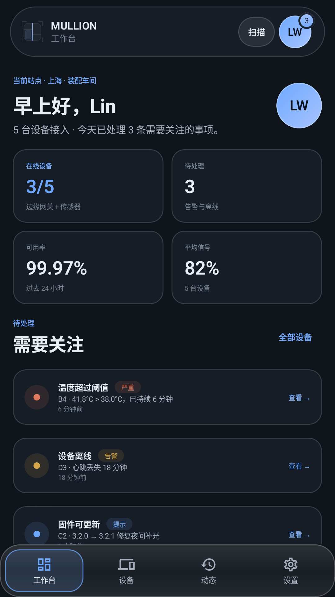

# MULLION SDK 文档

**One window. Every pane. / 一樘窗，处处合缝。**


MULLION 是开源的 **Android 原生自适应组件框架**：把宽度类、导航形态、分栏策略、折叠屏几何、窗口 inset 与明暗主题收束成一根可测试的窗棂，让业务 Screen 里不再出现 `if (width > 600)`。

## 这套文档包含什么

| 章节 | 内容 |
| --- | --- |
| [指南](architecture.md) | 架构、断点表、折叠屏、明暗主题、尺寸上下文、组件总览、View 层、发布与验证 |
| [设计风格](design-style.md) | 配色、字阶、玻璃配方、圆角、间距、明暗双主题的设计规范 |
| [API 参考](api/README.md) | `mullion-core` / `mullion-compose` / `mullion-view` 全部公开符号的签名与释义（自动生成） |

## 一分钟安装

```kotlin
// settings.gradle.kts
dependencyResolutionManagement {
    repositories {
        google()
        mavenCentral()
        maven { url = uri("https://jitpack.io") }
    }
}
```

```kotlin
dependencies {
    implementation("com.github.Mullion-Official.Mullion-Android-Kotlin-Compose:mullion-core:1.0.0")
    implementation("com.github.Mullion-Official.Mullion-Android-Kotlin-Compose:mullion-compose:1.0.0")
    // Android View / XML 互操作才需要
    implementation("com.github.Mullion-Official.Mullion-Android-Kotlin-Compose:mullion-view:1.0.0")
}
```

```kotlin
MullionTheme {                       // 跟随系统明暗
    MullionWindowProvider {          // 真实窗口 + 铰链 + insets
        AdaptiveScaffold(
            bottomBar = { OrbitNav(items, selected, onSelect) },
            rail = { OrbitNav(items, selected, onSelect) },
            drawer = { OrbitNav(items, selected, onSelect) },
        ) { _ ->
            MultiPane(
                list = { DeviceList() },
                detail = { DeviceDetail() },
                preview = { DevicePreview() },
            )
        }
    }
}
```

## 五分钟读完

1. [架构：一根窗棂管结构](architecture.md)
2. [断点表：320 / 480 / 600 / 840 / 1200](breakpoints.md)
3. [折叠屏与铰链](foldables.md)
4. [明暗主题与尺寸上下文](design-style.md)
5. [26 个模块总览](components.md)
6. [API 参考](api/README.md)

## 设计风格



MULLION 的视觉语言是「窗棂」而非「霓虹」：浅色优先、蓝色语义主色、可复现的玻璃配方、语义化 token。详见[设计风格](design-style.md)。

## 仓库

- 源码：https://github.com/Mullion-Official/Mullion-Android-Kotlin-Compose
- JitPack：https://jitpack.io/#Mullion-Official/Mullion-Android-Kotlin-Compose/1.0.0
- 演示视频与更多截图：仓库 `docs/` 目录
- 许可：Apache-2.0
